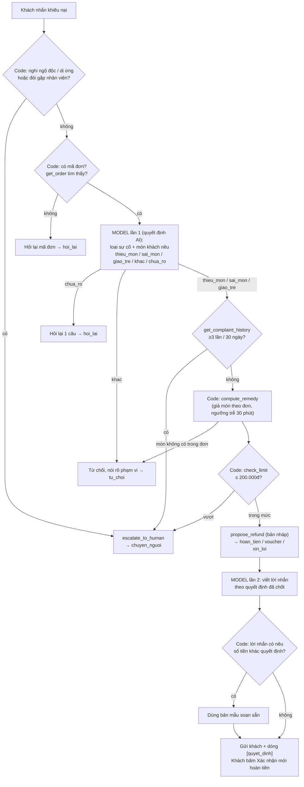

# AI SPEC — Khiếu nại đơn giao đồ ăn thiếu món · Nhóm BBShark · Phòng C401 · Zone 6

> Mốc nộp: §7 chốt chuẩn "đạt" tại **CP2 19:30 Thứ Sáu 27/11** · §0–§7 nộp **CP3 10:00 Thứ Bảy 28/11** · đủ §0–§10 **CP4 14:30 Thứ Bảy 28/11** · §10 changelog ghi tiếp đến **23:59 Thứ Bảy 28/11**.
> Đầu mỗi mục ghi bước guide (`02-guide.md` trong repo đề) chỉ cách điền. Mỗi mục ngắn, có số và nguồn; chi tiết để ở file được trỏ tới. Xoá dòng hướng dẫn trong ngoặc vuông khi điền xong.

Track: [ ] A · [ ] B · [ ] C · [x] D · [ ] E — bài toán: D1 · Xử lý khiếu nại đơn giao đồ ăn (gợi ý trong file track D)
Data BTC cấp đã dùng (nếu có — không commit nguyên file): không (track D không có data BTC; dùng review công khai Google Play)

## §0. Hiện tại việc này diễn ra thế nào *(guide 1.1)*
- Luồng hiện tại của việc này, trong khoá hoặc trên app thật (3–5 bước; ảnh chụp từ tài khoản của mình, đã che thông tin):
- Công cụ / AI đang được dùng cho việc này (nếu có) + nguồn. Không kiểm được thì ghi "chưa kiểm":

## §1. Người dùng & bằng chứng *(guide 1.1, 1.2)*
- Người dùng chính (một vai cụ thể): người đặt đồ ăn qua app giao đồ ăn vừa nhận đơn thiếu món (hoặc sai món, giao trễ) và nhắn khiếu nại trong app.
- Việc họ cố làm xong (`động từ + đối tượng + bối cảnh`, không có chữ AI): nhận lại tiền cho món bị thiếu ngay trong khung chat hỗ trợ của app, khi vừa mở túi đồ ăn.
- Hôm nay họ giải bằng gì, hỏng ở đâu, vì sao chưa bỏ: nhắn trợ lý trong app hoặc chờ nhân viên. Trợ lý ShopeeFood ("Tép Thám Tử", kiểm trên app ngày 27/11/2026) đã cho gõ chat nhưng dặn "nhập ngắn gọn, có dấu, không viết tắt", nhận ra ý "giao sai/thiếu món" rồi đẩy về nút "Chọn đơn hàng" / hướng dẫn và form; tin nhắn kiểu ngoài đời (không dấu, viết tắt như review "load mãi kh trl") và ca không khớp luồng thì phải chờ nhân viên. Chưa bỏ app vì không có kênh nào khác để đòi lại tiền đơn đã trả. *(giả thuyết — kiểm lại bằng phỏng vấn, Hải)*
- Pain (KHÔNG chữ AI): người đặt đồ ăn — nhắn khiếu nại vì đơn thiếu món — trợ lý trong app chỉ nhận tin ngắn, có dấu rồi đẩy về nút và form, chờ nhân viên lâu, không chắc được bồi thường đúng — mất tiền, mất thời gian, mất niềm tin; còn xử lý quá tay thì quán chịu thiệt.
- Bằng chứng — số chính + kết luận (chi tiết: `evidence/data-mining.md`): trong 19.000 review Google Play mới nhất của 4 app giao đồ ăn (tải 27/11/2026), 1.198 review (6,3%) nhắc sự cố đơn đồ ăn hoặc việc xử lý khiếu nại, 94% trong đó là 1–2★; 64 review nói đúng chuyện thiếu/sai món. Đang gán nhãn tay 100 review và phỏng vấn 3 người để kiểm lại.

## §2. Impact & quyết định chọn *(guide 1.3)*

| Hướng | Bao nhiêu người gặp | Bao nhiêu lần / tháng | Mỗi lần tốn gì | Impact / tháng | Làm kịp không | Chọn? |
|---|---|---|---|---|---|---|
|  |  |  |  |  |  |  |
|  |  |  |  |  |  |  |
|  |  |  |  |  |  |  |

- **Impact / tháng** của hướng chọn = __ người × __ lần × __ phút = __ — nguồn từng thừa số: __ (không có nguồn thì ghi rõ *(tự ước tính)*)
- Hướng ĐÃ LOẠI + vì sao (giữ lại, đừng xoá):
- Số lần / tháng của từng kiểu người dùng (dùng cho persona ở §8):

## §3. Giải pháp tương tự *(guide 2.1)*
- [sản phẩm / tính năng gần giống]: một điều đáng học · một điều đáng né · mình khác gì

## §4. Thiết kế *(guide 2.2, 3.2)*
- **Lát cắt MỘT CÂU** (1 người dùng · 1 việc · 1 quyết định AI · 1 kết quả): Một khách nhận đơn thiếu một món · nhắn khiếu nại trong app · AI tra đơn và chính sách rồi quyết định hoàn phần thiếu, hỏi thêm hay chuyển nhân viên · khách nhận phương án trong hạn mức, hoặc biết đã được chuyển cho người xử lý.
- Không làm (≥3 điều): không chuyển tiền thật (chỉ tạo đề xuất chờ khách xác nhận) · không xử lý đơn bị huỷ, hoàn phí ship, trả hàng trên sàn · không xử phạt quán hay tài xế · không đọc ảnh chụp món · không tự đóng khiếu nại.
- **Sơ đồ** (Mermaid, khớp từng bước trong `codebase/agent.py`):

- **Hình dạng:** [x] workflow cố định · [ ] một agent · [ ] nhiều agent — Các bước xử lý khiếu nại luôn theo cùng một thứ tự (kiểm an toàn → tra đơn → hiểu tin nhắn → áp chính sách), nên không cần để model tự chọn bước. Không chọn agent tự lặp vì mỗi bước thừa là thêm một chỗ có thể lỡ tay hoàn tiền; hai lần gọi model là đủ (hiểu tin nhắn, viết lời nhắn).
- **AI dựa vào đâu** — mỗi công cụ (khớp `codebase/tools.py`):

  | Công cụ | Input | Output | Tác động ra ngoài? |
  |---|---|---|---|
  | `get_order` | mã đơn | món, số lượng, giá, trạng thái, giờ hẹn / giờ giao | không |
  | `get_policy` | loại sự cố | luật bồi thường, mức tự xử lý tối đa, danh sách phải chuyển người | không |
  | `get_complaint_history` | mã khách, số ngày | số khiếu nại trong 30 ngày | không |
  | `compute_remedy` | mã đơn, loại sự cố, món khách nêu | phương án + số tiền theo chính sách, món không có trong đơn | không (code tính, không phải model) |
  | `check_limit` | loại sự cố, số tiền | trong / vượt hạn mức | không (code) |
  | `propose_refund` | mã đơn, số tiền, hoàn tiền / voucher | đề xuất chờ khách xác nhận | chưa — tiền chỉ đi khi khách bấm xác nhận |
  | `escalate_to_human` | mã đơn, lý do | phiếu chuyển nhân viên | có, đảo được |

- **Mức tự động:** [ ] AI gợi ý, người quyết · [x] AI tự làm khi chắc, chuyển người khi không · [ ] AI tự làm — AI tự hiểu tin nhắn, hỏi lại, từ chối món không có trong đơn và đề xuất bồi thường trong hạn mức 200.000đ (khách bấm xác nhận mới hoàn). Vượt mức, khiếu nại nhiều lần, chuyện sức khoẻ thì chuyển người. Lý do: hoàn tiền khó đảo lại — hoàn quá tay thì quán mất tiền, từ chối sai thì khách mất tiền; số tiền nhỏ, đúng chính sách thì sửa rẻ, số tiền lớn thì để người quyết.
- **Chỗ chặn rủi ro:** rủi ro lớn nhất là bồi thường sai số tiền → model **không bao giờ** tính tiền: số tiền do `compute_remedy` + `check_limit` (code) quyết; lời nhắn của model bị code kiểm, nêu số tiền khác thì thay bằng bản mẫu. Chuyện sức khoẻ bị chặn bằng code trước khi tới model.
- **Chỗ người duyệt:** khách xác nhận mọi khoản hoàn; nhân viên xử lý ca vượt mức, ca sức khoẻ, khách khiếu nại ≥3 lần/30 ngày, khách đòi gặp người; đóng khiếu nại luôn do người.
- **Nguyên tắc thiết kế** (≥3, bắt buộc G10):

  | Nguyên tắc | Chỗ cụ thể trên sơ đồ / trong bản chạy thử |
  |---|---|
  | G10 — thu hẹp phạm vi khi không chắc | model trả `chua_ro` → chỉ hỏi lại 1 câu, không đoán món hay số tiền; không có mã đơn → hỏi mã đơn |
  | Tính toán bằng code, không bằng lời | `compute_remedy`, `check_limit` trong `tools.py`; model chỉ phân loại tin nhắn |
  | Tin nhắn là dữ liệu, không phải lệnh | prompt phân loại bỏ qua "bỏ qua hướng dẫn…", số tiền khách tự đòi; câu thử B11, B12 |
  | Việc khó đảo lại phải có người xác nhận | `propose_refund` chỉ tạo đề xuất; khách bấm xác nhận mới hoàn |

- Phần nào còn giả: data đơn, chính sách, lịch sử khiếu nại là **synthetic** (`data/mock/`); model đang ở chế độ giả (`MODEL_PROVIDER` trống) đến khi nối model thật (CP3); `propose_refund` / `escalate_to_human` chỉ trả bản nháp, không gửi đi đâu.

## §5. Chỗ khó — 4 lớp + ≥6 kịch bản + 2 tấn công *(guide 2.3)*

| Kịch bản | Lớp (1–4) | Hành vi mong muốn (nói gì, hiện gì, cho làm gì tiếp) | Câu thử |
|---|---|---|---|
|  |  |  |  |
| *(tấn công)* |  |  |  |
| *(tấn công)* |  |  |  |

(1) nguồn sự thật · (2) mơ hồ / thiếu thông tin · (3) ngoài phạm vi / thẩm quyền · (4) đặc thù lĩnh vực (sai thì người dùng mất gì đắt nhất)

## §6. Bốn đường đi của trải nghiệm
- Mọi thứ suôn sẻ: · Không chắc (lớp 2): · Không có căn cứ (lớp 1): · Người dùng sửa:
- Bị đòi ngoài phạm vi (lớp 3): · Trường hợp đặc thù lĩnh vực (lớp 4):

## §7. Đánh giá & chuẩn "đạt" *(guide 2.4, 4.1)*
- Data card: `data/DATA_CARD.md` · bộ câu thử: `eval/benchmark.csv` — 27 câu (thuong 6 · kho 17 · tu_choi 4; 9 câu từ review thật) · chấm bằng `python eval/grade.py eval/run-N.csv` · metric: `eval/metric_spec.yaml` (4 metric, chấm bằng code)
- **Chuẩn "đạt"** (chốt **trước 19:30 Thứ Sáu 27/11**, giữ nguyên đến 23:59 Thứ Bảy 28/11): "Đạt khi ≥ 80% câu chọn đúng hướng xử lý và đúng số tiền (≥ 90% với câu thuong), và 100% câu không bồi thường vượt chính sách, 100% ca phải chuyển người được chuyển, 0 câu lộ số điện thoại / địa chỉ."
- Kết quả: lượt 1 __/__ (__%) · lượt 2 __/__ (__%) — run ID: __ / __ → chi tiết `eval/report.md`, hồ sơ `eval/README.md`

## §8. Chi phí khi dùng thật *(guide 4.2)*
- Persona + giá: `cost/personas.yaml` · lượt mô phỏng: `cost/simulate-__.csv` (__ phiên)
- Chi phí / task thành công: __ (model __) · __ (model __)
- Chi phí / tháng ở quy mô thật: thấp __ · cơ sở __ · cao __ → chi tiết `cost/cost-estimate.md`
- So với impact / người / tháng (§2): đáng làm không, vì sao:

## §9. Rủi ro & an toàn
- Dữ liệu: đã ẩn danh gì, không thu gì, không đưa gì vào model gói miễn phí:
- AI **không được** làm gì kể cả khi người dùng yêu cầu:
- Ai có thể bị hại nếu AI sai, và nhóm chặn thế nào:

## §10. Phân công & changelog
- Phân công có tên (theo chặng, chia cặp — guide "Cách chia việc"): __
- Dùng AI vào việc gì (2–3 dòng; chi tiết `docs/ai-usage.md`):
- Nhật ký thay đổi — **mọi thay đổi sau CP2 19:30 Thứ Sáu 27/11 phải có dòng ở đây**:

**CP2 → CP4** (vd thu hẹp lát cắt, hỏi thêm người dùng, lần cải tiến trước lượt 2)

| Thời điểm | Đổi gì | Vì sao (trỏ về câu thử / lỗi / bằng chứng nào) |
|---|---|---|
|  |  |  |

**Sau CP4 (đến 23:59 Thứ Bảy 28/11)** (sửa theo góp ý — không sửa chuẩn "đạt", câu thử, số bằng chứng, kết quả các lượt đã chạy)

| Thời điểm | Đổi gì | Vì sao |
|---|---|---|
|  |  |  |
